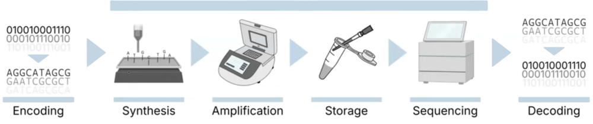
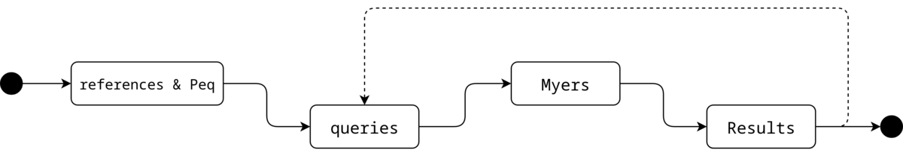
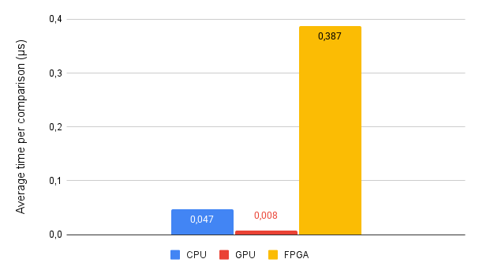
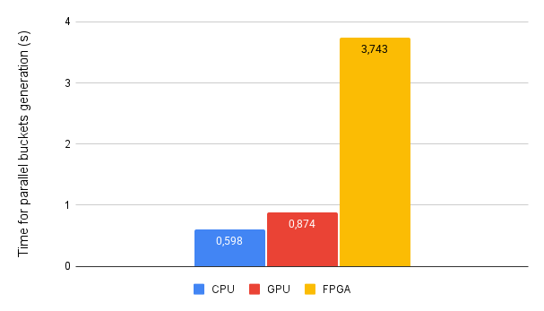

# FPGA Acceleration of DNA Strand Clustering

Bachelor thesis on accelerating **DNA strand clustering** – the edit-distance computations at the heart of DNA data storage – on an **Intel Agilex 7 FPGA**, with **SYCL / DPC++** and High-Level Synthesis (Intel oneAPI).

> hepia (HES-SO Geneva) · BSc in IT & Communication Systems, embedded systems · 2025
> Supervisor: Laurent Gantel · In collaboration with the University of Geneva and the European project **DNAMIC**
> 📄 [Thesis (83 pages)](docs/thesis.pdf) · [Summary](docs/summary.pdf) · [Poster](docs/poster-fr.pdf) · [Assignment](docs/assignment-fr.pdf) (French)

## Context

<p align="center"></p>

DNAMIC aims to store digital data in synthetic DNA. Sequencing introduces errors (substitutions, insertions, deletions), so every strand is amplified into many copies by PCR, and the reads must then be **clustered** back to their original strand. Clustering relies on the **Levenshtein (edit) distance**, which becomes very expensive for the hundreds of millions of strands targeted by the project.

## What I did

1. **Algorithm study** (semester project) – compared edit-distance algorithms and selected **Myers' bit-parallel algorithm**, then started a first VHDL implementation → [`semester-project/`](semester-project)
2. **FPGA platform bring-up** – Terasic **Agilex 7 Starter Kit** with the Intel **Open FPGA Stack** (OFS) and oneAPI board support, on a dedicated workstation.
3. **Tag Matcher** (`programs/`) – a SYCL implementation that matches DNA reads against reference tags with Myers' algorithm, in two memory models (**buffers/accessors** and **USM**), buildable for CPU, NVIDIA GPU, FPGA emulator, simulator and hardware.
4. **OneJoin** (`external/oneoligo/`) – adapted the existing [OneOligo](https://github.com/raja-appuswamy/oneoligo) SYCL implementation of OneJoin (an edit-similarity join based on CGK embedding and LSH bucketing) to compile for the FPGA, and moved its bucket-generation step into a dedicated FPGA kernel.
5. **Evaluation and analysis** – correctness against expected results, timing on CPU, GPU and FPGA, and an analysis of the HLS reports.

<p align="center"></p>

## Results

| Tag Matcher – time per comparison | OneJoin – bucket generation |
|:---:|:---:|
|  |  |

- **Correctness**: the Tag Matcher finds every expected match (**100 % recall**, 88.6 % precision, F1 = 93.9 %).
- **Performance**: both designs **run on the FPGA but are slower than on the CPU and the GPU** (e.g. 0.387 µs per comparison on the FPGA vs 0.047 µs on the CPU and 0.008 µs on the GPU).
- **Why**: the HLS reports show loops with latencies of 800–1600 cycles caused by scattered accesses to the external DDR memory, several main loops that could not be pipelined, and a low use of the FPGA resources. Code designed for CPUs/GPUs does not carry its performance over to an FPGA without architecture-specific work.
- **Next steps** proposed in the thesis: on-chip local memory and contiguous accesses, separate memory and compute kernels connected by pipes, removing false dependencies (`[[intel::ivdep]]`) to pipeline the loops, and replicating the Myers compute unit.

## Repository structure

```
├── programs/              Tag Matcher (SYCL, buffer and USM versions), makefile for every target,
│                          Python script to analyse the results
├── external/oneoligo/     OneOligo / OneJoin adapted for the FPGA (MIT, see below)
├── external/dataset-generator/   DNA dataset generator from UNIGE (submodule)
├── dataset/               small datasets and expected results
├── semester-project/      preliminary study: Myers' algorithm in C and VHDL
├── logs/                  weekly work logs
└── docs/                  thesis, summary, poster, assignment and figures
```

## Build

Requires the Intel oneAPI Base Toolkit (`icpx`); the FPGA hardware targets also need the board support package of the Agilex 7 Starter Kit.

```bash
git clone --recursive https://github.com/spyadrian/fpga-dna-strand-clustering.git
cd fpga-dna-strand-clustering/programs
make cpu          # CPU
make gpu          # NVIDIA GPU (CUDA backend)
make help         # all targets: FPGA emulator, simulator, HLS reports, hardware
```

## Tech

C++17 · SYCL / DPC++ · Intel oneAPI · High-Level Synthesis · Intel Agilex 7 · Open FPGA Stack · Quartus · VHDL · Python

## Credits & license

My code is released under the [MIT license](LICENSE).
`external/oneoligo/` is based on [OneOligo](https://github.com/raja-appuswamy/oneoligo) by Eugenio Marinelli, Raja Appuswamy et al. (MIT, © 2020 EURECOM – see its [LICENSE](external/oneoligo/LICENSE)); its full history, including my changes, is preserved in this repository.
The dataset generator is developed at the University of Geneva.
